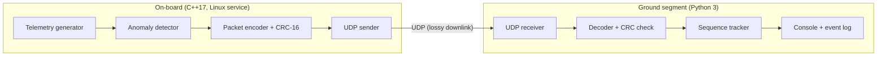

# Satellite Telemetry Monitoring & Test System


A small simulation of a satellite on-board data chain: a **C++ on-board process** generates telemetry and analyses it on board, a **Python ground segment** receives, verifies and logs it. Everything is tested automatically and runs as a **systemd service on Linux (Ubuntu 24.04, WSL2)**.

The idea mirrors on-board data analysis: the satellite evaluates its own data and flags problems, so the ground receives conclusions quickly instead of only raw values.

> This is a personal learning project and a simulation. It runs on a laptop; no flight hardware is involved.

## Architecture



## Packet format (big-endian, 19 bytes)

| Bytes | Field | Description |
|---|---|---|
| 0-1 | sync | fixed marker `A5 5A` |
| 2-3 | sequence | 16-bit counter, wraps at 65535 |
| 4-7 | timestamp_ms | time since start |
| 8 | type | `0x01` = housekeeping |
| 9 | payload_len | 7 |
| 10-16 | payload | battery_mv (u16), temperature in 0.01 °C (i16), solar_current_ma (u16), status_flags (u8) |
| 17-18 | crc16 | CRC-16/CCITT over bytes 0-16 |

Status flags: `0x02` low battery, `0x04` over-temperature, `0x08` fast temperature rise.

## Features

- Binary packet protocol with CRC; the decoder rejects corrupted, truncated or mis-framed packets
- On-board limit and rate-of-change checks that set status flags
- Ground-side loss detection from sequence numbers (handles wraparound, duplicates and late packets)
- Event log with OK / ALERT / GAP / DROPPED entries
- Runs as a hardened systemd service (restricted user, automatic restart on failure)

## Quick start

```bash
sudo apt install -y build-essential cmake ninja-build libgtest-dev python3-pytest
cmake -S . -B build -G Ninja && cmake --build build

# terminal 1: ground station (start it first)
python3 ground/receiver.py
# terminal 2: on-board simulator
./build/onboard
```

## Tests

```bash
./scripts/run_tests.sh
```

- C++ unit tests (GoogleTest): CRC check value, packet layout, anomaly rules
- Python unit tests (pytest): decoding, corrupted-byte rejection for every byte position, sequence tracking
- Integration test: the real C++ binary sends to a Python receiver over UDP
- GitHub Actions runs the whole suite on every push

## Deployment as a Linux service

```bash
./scripts/deploy.sh
systemctl status satellite-onboard
journalctl -u satellite-onboard -f
```

The unit runs as the unprivileged user `satellite`, restarts on failure and uses basic systemd hardening (`NoNewPrivileges`, `ProtectSystem`, `ProtectHome`, `PrivateTmp`).

## Fault injection

`scripts/netem_demo.sh` uses Linux `tc netem` to degrade the loopback link (packet loss + delay), runs the on-board process and compares injected loss with the loss the ground segment detected.

| Injected loss | Packets sent | Received | Loss detected by ground |
|---|---|---|---|
| 20 % (+100 ms delay) | 150 | 120 | 30 |
| 20 % (+100 ms delay) | 150 | 113 | 37 |
| 5 % (+100 ms delay) | 150 | 145 | 5 |

In every run, the loss detected by the ground equals packets sent minus packets received. The measured rate differs from the nominal one because netem drops packets randomly.

Other fault tests: killing the service with SIGKILL (systemd restarts it within about 2 s) and flipping every single byte of a packet (always rejected by the decoder).

## Operating procedures

Step-by-step runbooks, each verified by running it on the system:

1. [Nominal start-up and verification](docs/runbook-01-nominal-startup.md)
2. [Anomaly response](docs/runbook-02-anomaly-response.md)
3. [Crash recovery](docs/runbook-03-crash-recovery.md)

## Known limitations and next steps

- Loss of the *last* packets cannot be detected by sequence gaps alone
- A lost packet can hide the first packet of an alert; a real design would latch flags or repeat event packets
- The telemetry is simulated; no real sensors or flight software framework (cFS/F Prime) are used
- Next: cross-compile for ARM64 and run under QEMU, add a latched-flag mechanism, add a command uplink

## Project layout

```
onboard/   C++ on-board code (packet, anomaly detection, UDP)
ground/    Python ground segment (decoder, receiver, sequence tracker)
tests/     GoogleTest and pytest suites
scripts/   build/test, deployment and fault-injection scripts
deploy/    systemd unit file
docs/      operating procedures
```
